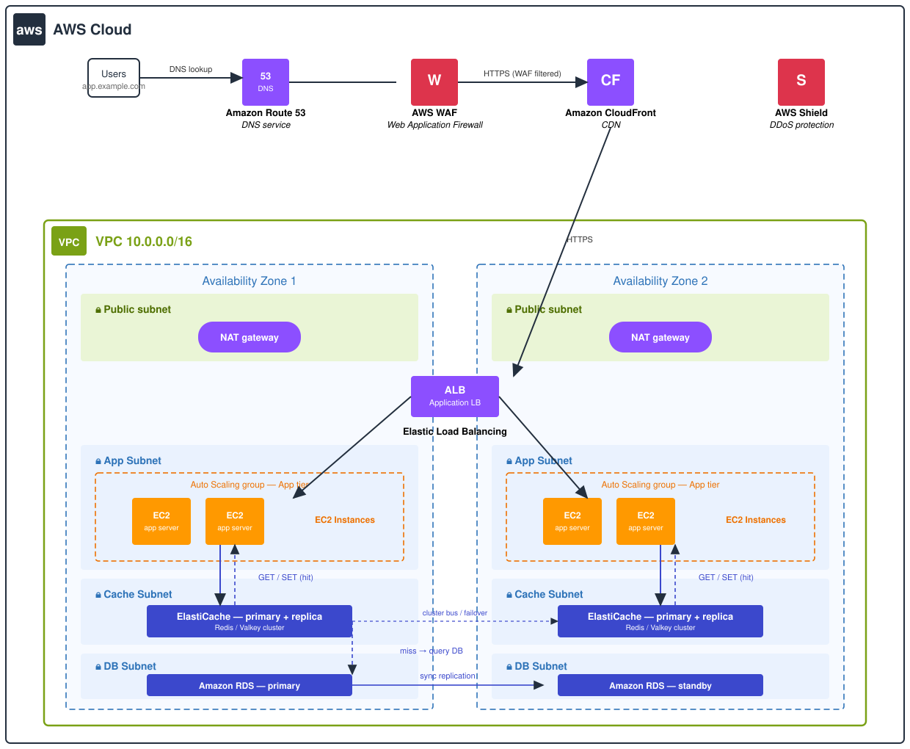

# AWS ElastiCache — Caching Done Right ⚡

   

> **TL;DR** — Your database is fast, but it was never meant to answer the same question 10,000 times per second. ElastiCache puts a blazing in-memory layer in front of your database so hot data is served in sub-milliseconds, failover is automatic, and your RDS stops melting at peak traffic. This guide covers cache-aside patterns, TTL discipline, clustering/sharding, and the cost guardrails people learn about too late.

## Why cache at all?

Every app has a handful of "hot" queries: the homepage feed, product listings, session tokens, leaderboards. Hitting a disk-based database for each one is wasteful — memory answers in **microseconds**, disk in **milliseconds**. The classic result of adding ElastiCache:

| Metric | Before cache | After cache |
|---|---|---|
| P99 latency (read) | 40–120 ms | < 2 ms |
| DB CPU at peak | 80–100% (crying) | 20–40% (chill) |
| Throughput | 1–3k reads/s | 100k+ reads/s |
| Cost | Bigger RDS or Multi-AZ panic upgrades | Small cache cluster + modest DB |

## The patterns (pick deliberately)

| Pattern | How it works | Good for | Watch out for |
|---|---|---|---|
| **Cache-aside** | App checks cache → miss → query DB → write back | General purpose, safest default | First request after expiry is slow (cold start) |
| **Read-through** | Cache loads from DB itself on miss | Thin app code | App must trust the cache layer |
| **Write-through** | Writes go to cache *and* DB synchronously | Strong read consistency | Slower writes |
| **Write-behind** | Writes go to cache, flushed to DB async | Firehose ingestion | Data loss window on crash |

For most teams: **cache-aside + TTLs** covers 80% of the value.

## Architecture



Traffic flows **Users → Route 53 → CloudFront → WAF → ALB → EC2 app tier → ElastiCache → RDS**. The cache sits in private cache subnets across two AZs, so a node failure fails over automatically while the app keeps serving from memory.

## TTL discipline (the part everyone skips)

- **Give everything a TTL.** No TTL = eventual memory exhaustion and mystery data.
- **Vary TTLs by access pattern** — user sessions: 30 min; product catalogs: 1–6 h; config/flags: 5 min.
- **Cache stampede guard:** add small jitter to TTLs so thousands of keys don't expire at the same second.
- **Invalidate on write** for data the business says must be fresh (prices, stock counts) — TTL alone is eventual consistency.

## Redis vs Valkey on ElastiCache

Redis and Valkey are protocol-compatible — your client code barely changes. Valkey (the open-source fork) is typically **cheaper** on ElastiCache Serverless and fine for new workloads; Redis is the battle-tested default. Use **Serverless** when traffic is spiky/unpredictable, **provisioned** (fixed clusters) when you can predict capacity and want the lowest per-request cost.

## Cost guardrails

- Node hours × node count × region — that's the bill. Delete dev/test clusters on weekends.
- Replication: every replica is a full extra node. Start with 1 replica per shard; add more only when read traffic proves you need it.
- Data tiering (`r6gd` nodes) offloads cold data to SSD — cheaper than keeping everything in RAM.
- Set CloudWatch alarms on `EngineCPUUtilization` and `CurrConnections` — growth in either predicts the next resize.

## Run the demo

```bash
pip install redis
python cache.py   # watch hits, misses, and TTL expiry live
```

## Quiz teaser 🧠

1. Your hot keys all expire at exactly 12:00 — what breaks at 12:00:01?
2. Why does write-behind risk data loss but write-through doesn't?

Full quiz with answers: [quiz.md](quiz.md)

---
*Day 28 of the cloud engineering series — one topic, one repo, every day. Part of the [daily cloud guide collection](https://github.com/sepkascurty-cpu?tab=repositories).*
